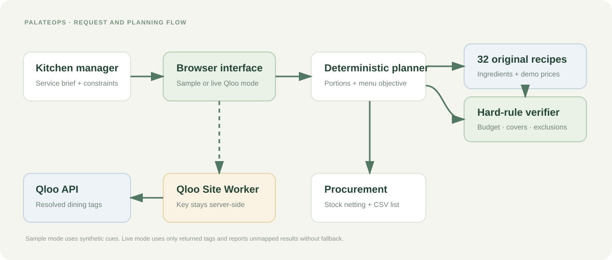

# PalateOps

**Food planning powered by cultural intelligence.**

**Try the public demo:** [palateops-qloo.zeynkbsi.chatgpt.site](https://palateops-qloo.zeynkbsi.chatgpt.site). It opens in Sample mode with labeled synthetic taste cues; Live Qloo mode needs an authorized event key.

PalateOps helps cafeteria teams turn attendance, budget, dietary rules and voluntary dining interests into a five-day operational menu. It compares an operational baseline with a taste-signal plan, checks hard constraints, totals estimated ingredient costs and prepares a shopping list.

> The default public demo uses synthetic taste cues. They are labeled and are not Qloo responses. Live Qloo requests require the event-issued credential and a separately hosted Node.js 22.19+ backend running the Qloo Harness. No live validation has been completed yet.

This source revision includes improvements awaiting publication to the public v4 Site. The optional model agent is implemented and fixture-tested; it has not made a live provider call. See [the implementation log](docs/IMPLEMENTATION_LOG.md) for release status.

## What you can try

- Generate a five-day, two-option cafeteria menu for Campus Commons.
- Produce five distinct daily menus or return infeasible when the hard rules cannot be met.
- Change daily covers, kitchen capacity, budget, vegetarian share, exclusions, equipment and stock on hand.
- Compare the same scenario with and without a taste signal.
- Review calculated daily spend, cuisine serving mix and highest purchase costs in the operations dashboard.
- See portions, recipe cost estimates, constraints and the tool trace.
- Apply a 25% attendance increase and 20% chicken-price increase, then replan.
- Restore one of the last six plans from the current browser session, or undo the supply shock.
- Export a CSV planning pack with the weekly menu, cost summary and consolidated shopping list.
- Switch to Live Qloo mode to use one to three dining names after an authorized key is configured.
- Choose the optional AI tool agent when its backend is configured; both plans must pass independent checks before display.

## Product screenshots

The screenshot shows labeled synthetic sample data, not a live Qloo response.

## How the taste signal works

Sample mode uses deterministic, synthetic profiles and makes no Qloo API call. Live mode sends up to three voluntary restaurant names to the same-origin Worker. The Worker forwards them to a separate Node.js 22.19+ service running the official Qloo Harness. The browser displays exact place matches for confirmation before the service requests restaurant recommendations and their nested tags. The planner maps only returned tag labels it can match to recipe cuisines. It does not fabricate Qloo scores or predict diner satisfaction. If no tags map to the catalog, the plan remains operational and the app reports that result.

See [the Qloo validation log](docs/QLOO_VALIDATION.md) for official references, the adapter contract and the live-test status.

## Planning model

The catalog contains 32 original demo recipes with illustrative ingredient quantities, estimated US-dollar prices, dietary tags and equipment needs. The planner checks stated kitchen capacity, daily budget and attendance, requires distinct daily menus, and returns an explicit infeasible result when it cannot satisfy the rules. It uses a deterministic greedy scoring heuristic; it is not an integer-programming proof of optimality.

Recipe prices are demonstrations, not supplier quotes. Nutrition figures are omitted because they have not been verified. Allergen metadata is a screening aid and does not guarantee safe preparation or prevent cross-contact.

## Architecture

See [docs/ARCHITECTURE.md](docs/ARCHITECTURE.md) for the data flow and [docs/OPTIMIZATION.md](docs/OPTIMIZATION.md) for assumptions and scoring.

The [AI agent guide](docs/AGENT.md) explains its model-directed tool loop, completion checks, configuration and live-validation status.

## Technology

- Vanilla JavaScript, HTML and CSS
- Cloudflare Worker-compatible Site runtime
- Node.js built-in test runner
- No browser-side Qloo key and no required user account

## Run locally

Requires Node.js 20 or later.

1. Run npm install.
2. Run npm test to build the Worker artifact and run unit, adapter and Worker route tests.
3. Install a Chromium browser for Playwright if one is not already available, then run npm run test:e2e for browser smoke coverage.
4. Run npm run preview and open the printed local URL for the sample interface.

The local static preview serves Sample mode only. Live Qloo runs through the deployed Site Worker after its backend URL and shared token are configured. Local live testing requires a Worker-compatible runtime configured to proxy to the Node backend.

## Environment

| Name | Required | Purpose |
| --- | --- | --- |
| QLOO_API_KEY | No for Sample mode; required for live mode | Event-issued credential stored only in the Qloo backend container's secret manager |
| QLOO_BACKEND_TOKEN | No for Sample mode; required for live mode | Random shared bearer token stored in the container and Site runtime secret managers |
| QLOO_BACKEND_URL | No for Sample mode; required for live mode | HTTPS origin of the separately hosted Node backend, stored in the Site runtime |
| PALATEOPS_AGENT_ENABLED | Only for the AI method | Set to `true` in the Node backend to enable model requests |
| OPENAI_API_KEY | Only for the AI method | Model credential stored only in the Node backend secret manager |
| OPENAI_MODEL | Only for the AI method | Explicit Responses-compatible model ID, configured in the Node backend |

The integration uses the hackathon kit's `qloo api search` and `qloo api insights` Harness commands. The Node backend owns the Qloo key; the Site Worker only forwards bounded requests using the shared backend token. See [the Qloo validation log](docs/QLOO_VALIDATION.md) for the dry-run contract and outstanding live checks.

## Deploy

The Site source manifest is .openai/hosting.json. Build output is written to dist/server/index.js and dist/.openai/hosting.json for the Worker hosting workflow. Build the Node.js 22.19+ backend from the repository root with `docker build -f qloo-backend/Dockerfile -t palateops-backend .`; it includes the shared planning modules. Set `QLOO_API_KEY` and `QLOO_BACKEND_TOKEN` in that container host, then configure `QLOO_BACKEND_URL` and the same `QLOO_BACKEND_TOKEN` in the Site runtime. Configure the optional model values only in the backend. Run `npm test`, build and publish the Site source, then verify the public URL and access mode. See [backend setup](qloo-backend/README.md).

Do not set a credential in a browser bundle, localStorage, repository, screenshot, or public demo instructions.

## Tests

Run npm test for recipe metadata, constraint verification, procurement, response normalization, Worker routes, the agent tool loop and the real subprocess adapter. Run npm run test:e2e for browser coverage of both planning methods, supply-shock replanning, history, CSV export and mobile overflow. Model and Qloo fixtures are synthetic; they make no external provider calls. Restricted runtimes may need local network permission for subprocess and browser execution.

## Hackathon references

- [Qloo Agentic Hackathon rules](https://qloo.devpost.com/rules)
- [Qloo public API docs](https://github.com/qloo/docs-public)
- [Qloo Hackathon Kit](https://github.com/qloo/qloo-hackathon-kit)
- [USDA FoodData Central API](https://fdc.nal.usda.gov/api-guide/)

## Known limitations

- No event key or container host was available when this version was built; live Qloo calls and the three-profile experiment remain pending.
- Qloo cuisine-to-recipe mapping may be empty or ambiguous.
- Ingredient prices and quantity needs are illustrative. Labor, yield loss, nutrition, equipment throughput and local currency conversion are not modeled.
- The 35% vegetarian share is a planning assumption, not measured attendance.
- Scenario persistence is browser-local; there is no account, database or server-side plan history.
- Recent plans are kept only for the open browser session and are cleared when the demo is reset or reloaded.
- The heuristic is deterministic but not globally optimal.

## License

MIT. See [LICENSE](LICENSE).
